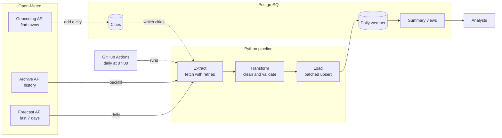

# Nigeria Weather Pipeline

[](https://github.com/initysl/weather-pipeline/actions/workflows/ci.yml)

A daily data pipeline that keeps a clean, trustworthy weather table for 15 Nigerian cities. It's built for an agritech startup whose analysts turn weather into planting and irrigation advice for farmers. It answers questions like:

- *How many rainy days did Kano get this month?*
- *Is Osogbo hotter than usual this week?*

[](https://datawrapper.dwcdn.net/wchVF/)

**Live charts, updated by the pipeline:** [Annual rainfall](https://datawrapper.dwcdn.net/wchVF/) · [Rainy season by month](https://datawrapper.dwcdn.net/0NSzC/) · [This week vs normal](https://datawrapper.dwcdn.net/2wToA/)

## What it does

- **Updates every morning:** fetches yesterday's weather at 07:00 Lagos time, automatically.
- **Covers the whole country:** 15 cities from the dry Sahel (Sokoto, Maiduguri) to the wet Niger Delta (Port Harcourt), and any Nigerian town can be added with one command.
- **Keeps the data correct:** every value is checked before it's stored, and suspect readings are flagged, not silently kept.
- **Never duplicates:** re-running a day, or a whole year, always leaves exactly one record per city per day.
- **Repairs itself:** each run re-checks the past week, so a missed day is filled in on the next run.

## How it works



| Stage | What happens |
|---|---|
| **Schedule** | GitHub Actions starts the pipeline every morning; history is loaded on demand. |
| **Extract** | Fetches each tracked city's weather: history from the archive, the latest week from the forecast service. Failed requests are retried. |
| **Transform** | Puts the data into a clean table and checks every value. Impossible readings are logged and removed. |
| **Load** | Writes to PostgreSQL in batches, updating existing days instead of duplicating them. |
| **Store** | One table of cities and one of daily weather, linked by city. New cities are found by name through Open-Meteo's geocoding. |
| **Serve** | Summary views turn the daily table into monthly totals, trends and comparisons with normal weather. |

## What analysts get

| Summary | Shows |
|---|---|
| Monthly summary | Average temperatures, total rainfall and rainy days per city, per month |
| 7-day rolling average | Short-term temperature trend per city |
| Hotter than usual | Each day compared with that city's normal for the same month |

```sql
SELECT city, rainy_days, total_rain_mm
FROM v_monthly_city_summary
WHERE month = date_trunc('month', CURRENT_DATE);
```

## Running it

### Setup

Requires Python 3.10+ and Docker.

```bash
git clone https://github.com/initysl/weather-pipeline.git && cd weather-pipeline
cp .env.example .env                        # set a database password
python -m venv .venv && source .venv/bin/activate
pip install -r requirements.txt
docker compose up -d                        # starts PostgreSQL with 5 starter cities
```

### Load weather

```bash
python -m src.pipeline --mode backfill --start 2024-01-01 --end 2026-11-14   # history
python -m src.pipeline --mode daily                                          # the latest 7 days
```

Add `--cities Kano "Ibadan, Oyo"` to run only some cities.

### Choose cities

```bash
python -m src.cities add Abuja --backfill-from 2024-01-01   # track a city and load its history
python -m src.cities search Ibadan                          # see matching places first
python -m src.cities list                                   # tracked cities
python -m src.cities deactivate Abuja                       # stop updating, keep its history
```

When several towns share a name, the main one (a capital or local government seat) is chosen; use `--state` to pick another.

### Schedule

In production, [GitHub Actions](.github/workflows/daily.yml) runs the daily load at 07:00 Lagos time against a hosted PostgreSQL:

1. Add the database connection string as a repository secret named `DATABASE_URL`.
2. Run the **Set up database** workflow once.
3. Run **Daily weather load** with `mode: backfill` to load history. The schedule handles the rest.

To run it on your own machine instead, add a cron job:

```cron
0 7 * * * cd /path/to/weather-pipeline && mkdir -p logs && .venv/bin/python -m src.pipeline --mode daily --no-raw >> logs/run.log 2>&1
```

### Test

```bash
pytest
```

## Design highlights

- **Safe to re-run:** every load updates existing records instead of adding new ones, so retries and overlapping runs never create duplicates.
- **Two data sources:** historical data comes from Open-Meteo's archive, recent days from its forecast service, which covers the archive's few-day delay.
- **Built for a cloud database:** records are written in batches of up to 1,000, not one at a time. Over a slow connection, that made loading about 40 times faster in testing.
- **One city's failure doesn't stop the others,** and any failure is reported.
- **Tested on every change** with automated tests, including a check that loading the same data twice changes nothing.

## Tech stack

Python · pandas · PostgreSQL · SQLAlchemy · Docker · GitHub Actions · pytest

## Limitations

- Open-Meteo's free API is for non-commercial use; a commercial deployment would need its paid plan.
- Weather values come from models on a 10–25 km grid, so nearby towns can share the same values, and rainfall can differ from local rain gauges.

## Acknowledgements

Weather data by [Open-Meteo.com](https://open-meteo.com/) (CC BY 4.0).
