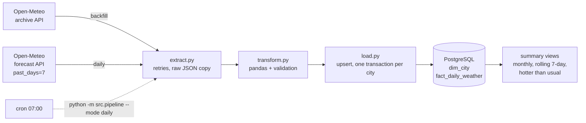
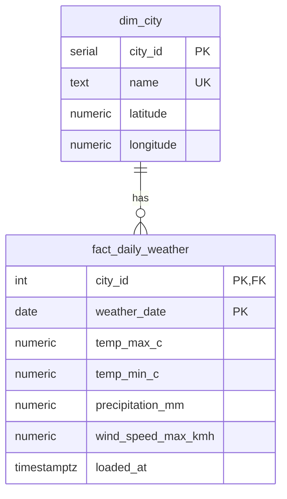

# weather-pipeline

A daily batch pipeline that keeps a clean, de-duplicated table of weather for the Nigerian cities an agritech startup serves, so analysts can answer questions like *"how many rainy days did Kano get this month?"* or *"is Osogbo hotter than usual this week?"*

## The scenario

The company sends planting and irrigation advice to farmers. That advice depends on recent weather, so the analysts need one table they can trust:

- **fresh**: updated every morning with yesterday's weather
- **correct**: values are validated before they land
- **free of duplicates**: re-running a job, or running two that overlap, never creates a second row for the same city and day

## Architecture



| Step | File | What it does |
|---|---|---|
| Extract | [src/extract.py](src/extract.py) | Calls Open-Meteo per city, retries failures with backoff, saves the raw JSON to `data/raw/` |
| Transform | [src/transform.py](src/transform.py) | Turns the API's parallel arrays into a DataFrame, renames columns, validates |
| Load | [src/load.py](src/load.py) | Syncs `dim_city`, upserts rows into `fact_daily_weather` |
| Orchestrate | [src/pipeline.py](src/pipeline.py) | Command-line entry point, runs each city independently, exits non-zero on failure |
| Config | [src/config.py](src/config.py) | Cities, endpoints, validation bounds, DB connection from `.env` |

## Schema



Definitions: [sql/schema.sql](sql/schema.sql). The primary key `(city_id, weather_date)` is what makes the whole pipeline safe to re-run.

**Analyst views** ([sql/summaries.sql](sql/summaries.sql)):

| View | Answers |
|---|---|
| `v_monthly_city_summary` | Average max/min temperature, total rain, rainy days (> 1 mm) per city per month |
| `v_temp_7day_rolling` | 7-day rolling average of max temperature per city |
| `v_hotter_than_usual` | Each day's max temperature vs that city's average for the same month in previous years (`anomaly_c`, `hotter_than_usual` = more than 2 °C above) |

```sql
-- How many rainy days did Kano get this month?
SELECT rainy_days FROM v_monthly_city_summary
WHERE city = 'Kano' AND month = date_trunc('month', CURRENT_DATE);

-- Is Osogbo hotter than usual this week?
SELECT ROUND(AVG(anomaly_c), 1) AS avg_anomaly_c FROM v_hotter_than_usual
WHERE city = 'Osogbo' AND weather_date >= CURRENT_DATE - 7;
```

## Running it

### Setup

```bash
cp .env.example .env                      # set a real POSTGRES_PASSWORD
python -m venv .venv && .venv/bin/pip install -r requirements.txt
source .venv/bin/activate
docker compose up -d                      # Postgres 16; applies schema.sql and summaries.sql on first start
```

The SQL files only run automatically when the database volume is empty. To apply changes to an existing database:

```bash
docker exec -i weather-db psql -U weather -d weather < sql/schema.sql
docker exec -i weather-db psql -U weather -d weather < sql/summaries.sql
```

### Backfill and daily modes

Run from the project root with `-m` (modules import each other as `src.…`):

```bash
# History, from the archive API
python -m src.pipeline --mode backfill --start 2024-01-01 --end 2026-11-08

# Daily: re-fetches the last 7 complete days from the forecast API
python -m src.pipeline --mode daily

# Any mode can be limited to some cities; --no-raw skips the JSON copy
python -m src.pipeline --mode daily --cities Kano Osogbo --no-raw
```

The exit code is 1 if any city failed, so a scheduler can flag the run.

### Scheduling (cron)

Run daily mode at 07:00 (the cron times use the machine's time zone, here Africa/Lagos):

```cron
0 7 * * * cd /path/to/weather-pipeline && mkdir -p logs && .venv/bin/python -m src.pipeline --mode daily --no-raw >> logs/run.log 2>&1
```

Add it with `crontab -e`. Postgres restarts with Docker (`restart: unless-stopped`), so the job works after a reboot. Because daily mode re-fetches 7 days, a missed run (machine off, API down) is repaired by the next successful one.

### Tests

```bash
pytest
```

- `test_transform.py`: uses a real sample response ([tests/fixtures/sample_response.json](tests/fixtures/sample_response.json)) and checks column names, data types and every validation rule
- `test_load.py`: loads the same data twice and asserts the row count doesn't change; also checks that values update and NaN becomes NULL. It runs against the Docker database inside a transaction that is rolled back, and is skipped if the database is down.
- `test_extract.py`: checks the endpoint and parameters each mode sends, using a fake HTTP session (no network)
- `test_pipeline.py`: command-line validation

## Design decisions

**Upsert, not insert.** Every load is `INSERT ... ON CONFLICT (city_id, weather_date) DO UPDATE`. Any run, for any range, any number of times, leaves exactly one row per city per day holding the latest values. This is what lets every other part of the pipeline be relaxed about overlap: retries, re-runs and overlapping windows cost nothing. `df.to_sql()` can't do this, so the load uses SQLAlchemy `text()` with named parameters.

**Why `past_days=7` in daily mode.** Fetching only yesterday would make every failure permanent: if the job misses a day, nothing ever goes back for it. Re-fetching a rolling week means any run repairs the previous six days, and because loads are upserts, the overlap is free. `forecast_days=0` stops it from loading today (not finished yet) or forecasts.

**Why the archive delay matters.** The archive API is built from reanalysis data, which is published a few days behind real time. Its newest days can be missing or provisional. So the pipeline uses two sources: the archive for backfills, the forecast API for the last week. The two come from different weather models and can differ slightly (on 2026-11-13 Kano's max was 32.1 °C in the archive and 32.3 °C in the forecast API). Recent rows therefore hold forecast-API values. Re-running a backfill over older months replaces them with archive values; because of the upsert, that's safe to do whenever needed.

**Validate in transform, and be explicit about what happens.**
- Problems with dates (missing, duplicated, gaps) **stop the run** for that city, since the date is part of the key and the batch can't be trusted.
- Implausible values (temperature outside −10 to 55 °C, negative rain or wind, max below min) are **logged with the full row and dropped**, never silently.
- Missing measurements are **kept as NULL** and counted in the log, because Open-Meteo sometimes leaves the newest day blank and dropping it would lose the whole day.
- NaN is converted to NULL before loading: Postgres `NUMERIC` accepts `'NaN'` as a value, which would make `AVG()` return NaN.

**One transaction per city.** Each city's rows commit together or not at all, and one city failing (bad data, API error) doesn't block the others. The run still exits with code 1 so the failure is noticed.

**Retries with backoff.** Network calls fail. Connection errors and 429/5xx responses are retried 4 times with exponential backoff (`urllib3.Retry`). 4xx errors aren't retried; Open-Meteo's explanation is logged instead.

**Raw JSON copies.** Each API response is saved to `data/raw/` (ignored by git), so a transform bug can be fixed and the data reprocessed without calling the API again.

**Star schema.** City details live once in `dim_city`; the fact table stores only `city_id`. Cities are defined in `config.py` and synced on every run (`ON CONFLICT (name) DO UPDATE`), so correcting coordinates in config updates the database.

**Views, not tables, for summaries.** The data is small (a few thousand rows), so views are fast enough and are always up to date with no refresh step. The rolling average uses `RANGE BETWEEN INTERVAL '6 days' PRECEDING` instead of `ROWS BETWEEN 6 PRECEDING`, so a missing day can't stretch the window past 7 days; `days_in_window` shows when it covers fewer.

## Project layout

```
src/            config, extract, transform, load, pipeline
sql/            schema.sql, summaries.sql
tests/          pytest tests and a sample API response
data/raw/       raw API responses (git-ignored)
logs/           cron output (git-ignored)
```
